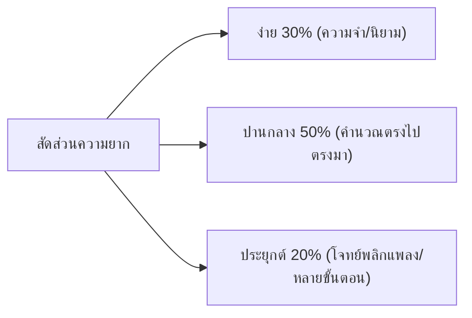

# แผนยกระดับระบบและการเตรียมเนื้อหาข้อสอบ (PLAN.md)
**โปรเจกต์:** Final-sa-maa-chik (เว็บฝึกทำแนวข้อสอบปลายภาค ม.4)  
**เป้าหมายหลัก:** เพื่อนเข้าใช้งานได้ทันทีโดยไม่ต้องสมัครสมาชิก (Zero-friction) + แอดมินคุมระบบได้จริง เพิ่ม/ลบข้อสอบได้สะดวก + ข้อสอบและชีตสรุปตรงกับที่เรียนในห้องสอบมากที่สุด

---

## 🎯 1. ทิศทางการพัฒนาระบบ (System Architecture Decisions)

### 1.1 ประสบการณ์ผู้ใช้ฝั่งนักเรียน (Student Experience)
* **คงระบบ Guest Mode 100% (ไม่ต้องสมัครสมาชิก):**
  * เพื่อนทุกคนที่ได้ลิงก์ สามารถกดเลือกวิชาแล้วเริ่มฝึกทำข้อสอบได้ทันทีใน 1 วินาที
  * ระบบจดจำประวัติคะแนน, จุดอ่อนที่ทำผิดบ่อย (Weak Topics), และกระดาษทดผ่าน Cookie Session ประจำเครื่อง
  * ไม่มีหน้าบังคับกรอกรหัสผ่านหรืออีเมลให้เสียเวลาตอนใกล้สอบ

### 1.2 ระบบฝั่งผู้ดูแล (Admin & Content Management)
* **ระบบล็อกอินแอดมินใช้งานได้จริง:**
  * ล็อกอินผ่านหน้า `/admin` โดยใช้รหัส `ADMIN_CODE` ที่กำหนดในไฟล์ `.env` (เปลี่ยนรหัสได้ตามใจชอบ)
  * ได้รับ Cookie `fep_admin` ที่มีอายุ 30 วัน ไม่หลุดบ่อย
* **ความสามารถในการ "เอาข้อสอบออกได้" (Exam Removal):**
  * มีปุ่ม **"ลบถาวร" (Trash Icon)** ในแท็บชุดข้อสอบ รองรับการลบชุดข้อสอบเก่าที่ตกยุคหรือผิดพลาดออกจากระบบได้ทันที
  * มีปุ่ม **"เก็บถาวร" (Archive)** หากต้องการซ่อนไม่ให้นักเรียนเห็น แต่ยังเก็บข้อมูลไว้ดูย้อนหลัง

---

## 📚 2. คู่มือการสรุปเนื้อหา: ทำอย่างไรให้ตรงกับที่เรียนและแนวข้อสอบที่สุด?

เพื่อให้ข้อสอบในเว็บจำลองข้อสอบจริงได้แม่นยำที่สุด ต้องใช้กระบวนการ **"ย้อนรอยข้อสอบ (Reverse-Engineering Blueprint)"** โดยมีขั้นตอนดังนี้:

### 2.1 สิ่งที่ต้องรวบรวมจากโรงเรียน (Inputs Required)
1. **ตารางแนวข้อสอบ / Blueprint ที่ครูแจก (สำคัญที่สุด ⭐⭐⭐):**
   * ครูจะบอกชัดเจนว่า: แต่ละวิชาออกกี่ข้อ, ข้อละกี่คะแนน, มีปรนัยกี่ข้อ, อัตนัยกี่ข้อ, สอบกี่นาที
   * สัดส่วนแต่ละบท (เช่น ฟิสิกส์: แรงและกฎนิวตัน 8 ข้อ, สมดุลกล 6 ข้อ, งานและพลังงาน 6 ข้อ)
2. **ชีตเรียน / สไลด์ Presentation ของครูผู้สอน:**
   * **นิยามเฉพาะ:** แต่ละโรงเรียนอาจใช้คำศัพท์หรือสูตรลัดไม่เหมือนกัน ต้องอิงตามสไลด์ครู
   * **ตัวอย่างโจทย์ในห้อง:** จุดที่ครูเน้นย้ำในคาบว่า *"ข้อนี้ระวังโดนหลอก"* หรือ *"ออกสอบแน่ๆ"*
3. **แบบฝึกหัดท้ายบท & ควิซย่อยเก็บคะแนน (Homework & Quizzes):**
   * ครูส่วนใหญ่มักนำตัวเลขจากแบบฝึกหัดมาดัดแปลงเป็นข้อสอบจริง
4. **รูปภาพ แผนภาพ และตาราง:**
   * เช่น ภาพชั้นโครงสร้างโลก (ดาราศาสตร์), รูปวงจรไฟฟ้า/รอก (ฟิสิกส์), แผนภาพ VSEPR (เคมี), ภาพเซลล์แบ่งตัว (ชีวะ)

---

### 2.2 โครงสร้างข้อสอบ 3 มิติ (การออกแบบข้อสอบคุณภาพสูง)



1. **ระดับความจำ (Recall - 30%):**
   * วัดนิยาม คำศัพท์ สูตร กฎเกณฑ์พื้นฐาน
   * *ตัวอย่าง:* "ชั้นบรรยากาศใดที่มีสถานะเป็นของเหลว", "สมบัติการสลับที่ของการคูณ", "สูตรคำนวณพลังงานจลน์"
2. **ระดับความเข้าใจและการคำนวณ (Application - 50%):**
   * โจทย์แทนค่าคำนวณตรงๆ 1–2 สเต็ป ไม่ซับซ้อนเกินไป
   * *ตัวอย่าง:* "วัตถุมวล 2 kg ถูกแรง 10 N กระทำ จะมีความเร่งเท่าใด"
3. **ระดับวิเคราะห์และจุดดัก (Deep Analysis - 20%):**
   * ข้อสอบที่มีตัวเลือกแนว "ข้อใดถูกต้อง / ข้อใดไม่ถูกต้อง" หรือโจทย์ที่ต้องแปลงหน่วยก่อนคำนวณ

---

### 2.3 เทคนิคการสร้าง "ตัวลวงคุณภาพ" (Smart Distractors)
ข้อสอบที่ดีต้องไม่ตั้งตัวเลือกมั่ว แต่ตัวเลือกที่ผิดต้องเป็น **"สิ่งที่เพื่อนมักคิดเลขผิดจริงๆ"**:
* **ลืมเปลี่ยนหน่วย:** เช่น ถามเป็นเมตร แต่โจทย์ให้มาเป็นเซนติเมตร (ให้มีช้อยส์ที่ลืมเปลี่ยนหน่วยดักไว้)
* **ลืมกลับเครื่องหมาย:** เช่น อสมการคูณด้วยลบแล้วลืมกลับเครื่องหมาย $\le$ เป็น $\ge$
* **จำสูตรสลับกัน:** เช่น ใช้สูตร $\sin$ แทน $\cos$, ลืมใส่กำลังสองใน $E_k = \frac{1}{2}mv^2$

---

### 2.4 การเขียนเฉลยที่ "สอนคิด" (Explanations)
* ❌ **แบบที่แย่:** "ตอบ ข้อ 2 เพราะถูกแล้ว"
* ✅ **แบบที่เพื่อนชอบ:** 
  1. บอกสูตร/ทฤษฎีที่ใช้
  2. แสดงวิธีทำทีละบรรทัดชัดเจน
  3. **บอกว่าทำไมช้อยส์อื่นถึงผิด** (เช่น *"ช้อยส์ 3 ผิดเพราะลืมคิดแรงเสียดทาน"* จะช่วยให้เพื่อนจำได้แม่นขึ้นทันที)

---

## 🛠️ 3. การเตรียมระบบและการล้างเนื้อหาเก่า (Clean Slate)

### 3.1 สคริปต์ล้างข้อมูล (`npm run db:clean`)
เราได้จัดทำสคริปต์ `prisma/reset-clean-subjects.ts` ไว้แล้ว:
* **สิ่งที่ลบออก:** ข้อสอบเก่าทั้งหมด (`QuestionSet`, `Question`), ชีตสรุปเก่า (`StudyGuide`), ประวัติคะแนนเดิม (`Attempt`, `AttemptAnswer`)
* **สิ่งที่คงไว้:** โครงสร้าง 8 วิชาหลักของ ม.4 พร้อมสีและไอคอนมาตรฐาน ได้แก่:
  1. `ค31101` คณิตศาสตร์พื้นฐาน
  2. `ค31201` คณิตศาสตร์เพิ่มเติม
  3. `ว31201` ฟิสิกส์
  4. `ว30221` เคมี
  5. `ว32241` ชีววิทยา
  6. `ว30261` โลก ดาราศาสตร์ และอวกาศ
  7. `ท31101` ภาษาไทย
  8. `อ31101` ภาษาอังกฤษ
  9. `ส31101` สังคมศึกษา

### 3.2 ขั้นตอนการรันเมื่อพร้อมเคลียร์ข้อมูล:
```bash
# 1. ตรวจสอบว่าเปิดฐานข้อมูล PostgreSQL เรียบร้อยแล้ว (หรือ npm run dev:db)
npm run dev:db

# 2. สั่งล้างเนื้อหาเก่าทั้งหมด เหลือเฉพาะวิชาหลัก
npm run db:clean
```

---

## 📋 4. รูปแบบ JSON Template สำหรับนำเข้าข้อสอบใหม่

เมื่อสรุปข้อสอบวิชาใหม่เสร็จแล้ว สามารถก๊อปปี้ไปวางในหน้า `/admin` (แท็บ "ชุดข้อสอบ" → นำเข้าข้อสอบจาก JSON) ได้ทันที:

```json
{
  "subjects": [],
  "questionSets": [
    {
      "title": { "th": "แนวข้อสอบฟิสิกส์ กลศาสตร์ปลายภาค (20 ข้อ)" },
      "subjectCode": "ว31201",
      "difficulty": "MEDIUM",
      "recommendedMinutes": 60,
      "revealMode": "AFTER_SUBMIT",
      "questions": [
        {
          "type": "MCQ",
          "prompt": "วัตถุมวล $2\\text{ kg}$ วางบนพื้นราบเกลี้ยง ถูกแรง $10\\text{ N}$ ดึงในแนวราบ จงหาความเร่งของวัตถุ",
          "options": [
            { "key": "A", "text": "$2\\text{ m/s}^2$" },
            { "key": "B", "text": "$5\\text{ m/s}^2$" },
            { "key": "C", "text": "$10\\text{ m/s}^2$" },
            { "key": "D", "text": "$20\\text{ m/s}^2$" }
          ],
          "answer": { "kind": "MCQ", "correctKeys": ["B"] },
          "explanation": "จากกฎข้อที่ 2 ของนิวตัน $\\sum F = ma$\nแทนค่า $10 = 2 \\times a \\implies a = 5\\text{ m/s}^2$",
          "points": 1
        }
      ]
    }
  ]
}
```

---

## 💡 5. ข้อเสนอแนะเพิ่มเติมที่ควรใส่ลงไปในระบบ (Recommended Features)

1. **โหมดเฉลยทันที vs โหมดจับเวลาเสมือนสอบจริง:**
   * เพิ่มปุ่มให้ผู้เรียนเลือกว่าอยากทำแบบ **"ซ้อมทีละข้อ (รู้ผลทันทีพร้อมเฉลย)"** หรือ **"จำลองสอบจริง (จับเวลาแล้วดูคะแนนรวมตอนท้าย)"**
2. **การ์ดสรุปผลคะแนนแบบแชร์ได้ (Shareable Score Card):**
   * เมื่อทำข้อสอบเสร็จ ทำปุ่มกดก็อปปี้หรือเซฟรูปผลคะแนน พร้อมข้อความน่ารักๆ เช่น *"พร้อมสอบฟิสิกส์แล้ว 85%! มาลองทำกัน"* เอาไว้แชร์ลงสตอรี่ไอจีหรือกลุ่มห้อง
3. **ระบบสุ่มคำถามและสลับช้อยส์ (Shuffle Questions & Options):**
   * ระบบมีฟิลด์ `shuffleQuestions` และ `shuffleOptions` รองรับอยู่แล้ว ช่วยให้เพื่อนทำซ้ำกี่รอบข้อสอบก็ไม่จำตำแหน่งช้อยส์
4. **ชีตสรุปสูตรหน้าเดียว (Cheat Sheet Bar):**
   * กางดูสูตรลัดหรือสรุปย่อได้ขณะทำข้อสอบ โดยไม่ต้องสลับแท็บไปหาที่อื่น
